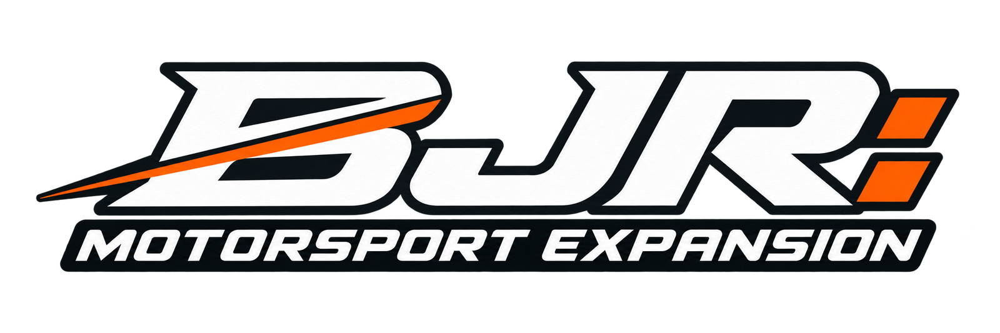
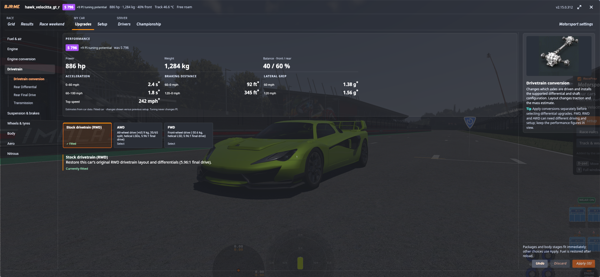
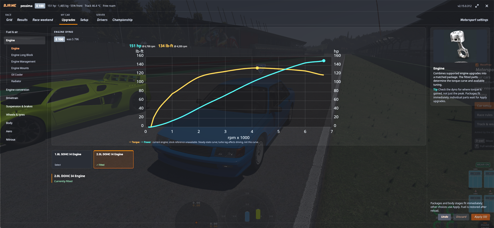
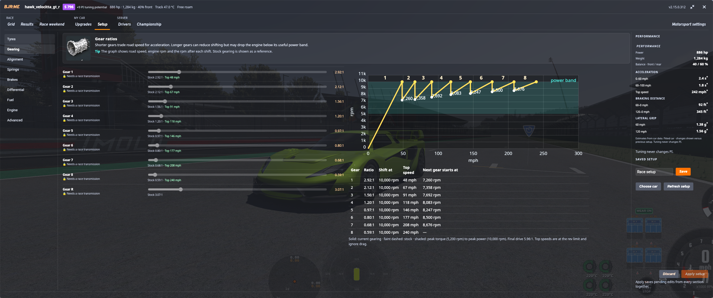
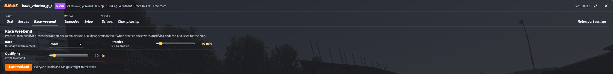
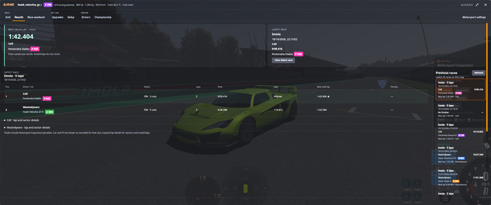
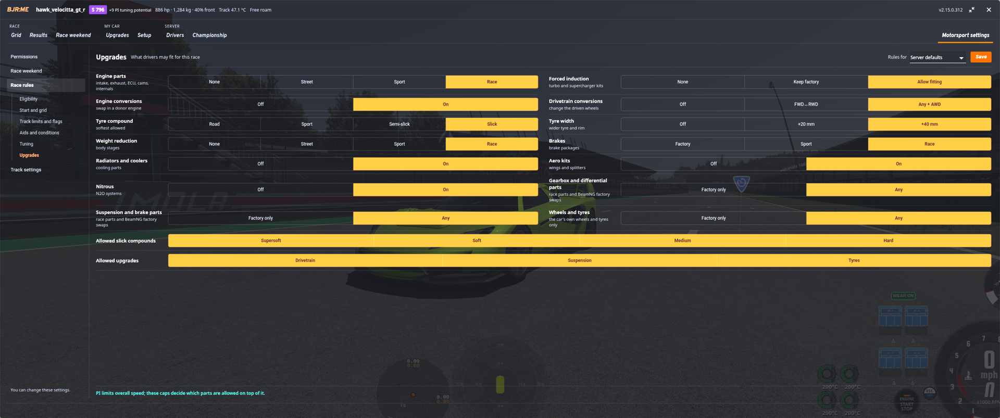
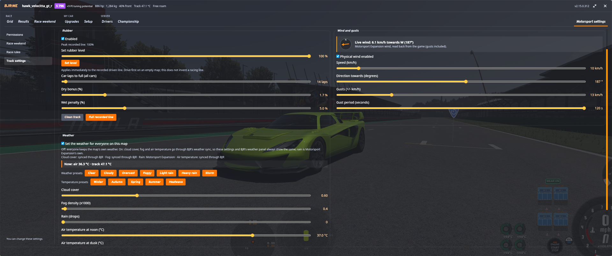

**A motorsport layer for [BeamJoy-Revived](https://github.com/foodcache3/BeamJoy-Revived) on BeamMP:** Forza Motorsport-style
car classes and Performance Index, a full upgrade workshop for Automation cars, race control and a
living track: rubbered racing line, marbles and track temperature.

> **Open beta.** Expect changes between versions; see [CHANGELOG.md](CHANGELOG.md). What's next is
> in [ROADMAP.md](ROADMAP.md). Bugs, questions and race nights: **[join the Discord](https://discord.gg/m6urHk6EAK)**.

## How it started
BJR:ME started as something I built for myself and my friends. We race Automation cars on our own
BeamMP server most weekends, and I wanted a more curated racing experience than free-for-all
lobbies: cars grouped into fair classes, real upgrade paths like in Forza, proper race procedures,
and a track that changes as you drive on it. It began as a small race-preparation window and grew
from there, one race night at a time, into the expansion it is now. I'm sharing it so other servers
can race the same way.

   -Sillyw0rld

## What it does

### Car classes and Performance Index (PI)

*Every Automation and BeamNG car gets a class and Performance Index in the vehicle list (PI values
in this screenshot come from an earlier build, before the class curve).*

- **Classes E, D, C, B, A, S, R, P and X with a 100–999 PI,** on Forza Motorsport's class bands. Each
  class is progressively harder to reach: road cars climb easily, super and hypercars climb slowly
  through R and P, and X is reserved for extreme builds.
- **Calibrated ratings:** PI comes from a lap-time model of the car's physics (acceleration, braking
  and cornering). Stock ratings are calibrated against cars measured in game; upgrades are rated by
  how much they change the car.
- **Parts change PI, tuning never does** (as in Forza). Race parts that unlock tuning carry a small,
  visible "tuning potential" bonus.
- Ratings show in the vehicle selector, on the grid, in the race HUD and in results.

### Upgrade workshop

**Automation cars** get a full Forza-style upgrade path, generated on the server for the cars it has:
- **Tyres:** compounds from road to race slicks (KTS-aware), width −20 to +40 mm on a matching rim.
- **Aero kits, weight reduction (Street / Sport / Race), brakes** (Sport / Race).
- **Engine:** intake, exhaust, ECU, camshaft, forged internals, displacement, turbochargers and
  superchargers, intercooler, oil cooler and **radiators** (sized so a turbo-converted car stops
  overheating on a hot grid), with a live **dyno**.
- **Engine conversions** from a curated donor-engine lineup, screened against each car's engine bay,
  and **drivetrain conversions** (FWD / RWD / AWD). The donors are included.

**BeamNG's own cars** can fit their compatible factory parts (engines, gearboxes, suspension,
brakes, wheels and tyres, wings), found through BeamNG's own part-slot compatibility. They also get
BJR:ME's own upgrades: **weight-reduction stages** (33 models), **Sport and Race brakes** (31 models)
and, in beta, **tyre compounds and widths** (Covet, ETK 800, D-Series and SBR; their PI still reads
about 30 high). These are separate add-on parts built from the cars' factory parts; the factory
files themselves are never modified.

Every section of the workshop and of **Setup** has a short guide with a picture: what the part or
setting does and how to use it.

### Setup

- Suspension, aero, brakes, differential, fuel and gearing, with permissions that follow the fitted
  parts (Race parts unlock their sliders; final drive is always adjustable).
- A gearing graph next to the sliders, performance figures, and saved setups.

### Race weekend

- **Practice, then qualifying, then the race** on one BeamJoy-Revived race. Qualifying starts by itself
  when practice ends; when qualifying ends, drivers on a lap finish it and the grid is set.
- Everyone gets a short announcement at each step, a **Go to track** button, and live session
  standings with sector times (purple: session best, green: own best).
- Grids from qualifying, reversed top N or handicap (lowest PI first), through BeamJoy-Revived's
  official grid-order hook.

### Race HUD
- Three small pieces at the top of the screen, so the bottom centre stays free for the game's own
  apps: a **standings tower** (class / PI, gaps, penalties), a **timing box** (position, lap time,
  live delta, last and best lap, sector strip) and a **gap strip** (car ahead and behind).
- It runs on BeamJoy-Revived's own race data, so positions and gaps are the same for everyone.
- The practice / qualifying HUD has the same layout, with live sector deltas.
- Start lights and false starts, track limits (with a short pill when you cut), yellow flags.
- Results history, championships, driver statistics and a safety rating.

### Motorsport settings

The last tab of the window. Everyone can read it; changing it needs permission.
- **Permissions by BeamJoy group:** who may start race weekends, edit rules and track settings, and
  use race control.
- **Race rules** per race or as server defaults: eligibility (classes, PI min / max), start and grid,
  track limits and flags, driving aids, tuning limits, and **upgrade caps**: engine parts level,
  forced induction, engine and drivetrain conversions, tyre compound and width, weight reduction,
  brakes, radiators, aero, nitrous, and factory-only rows. Parts a race does not allow are locked in
  the workshop with the reason, and Ready is refused while a fitted part breaks a cap.
- **Track settings:** the rubbered racing line and marble sizes (close and far), wind and gusts, and the weather (clouds, fog, rain,
  air temperature by time of day).

### A living track

- **Rubbered racing line** that builds up lap by lap and adds grip, plus **marbles** off the line:
  rubber pieces you can see coming from 80 m (close and far size set in Track settings).
  Driving through them costs a little grip, and your tyres pick some up for a few corners (a
  "Marbles on tyres" pill shows it). Every pass thins them out a little for everyone.
- **Track temperature** from air temperature, sun, clouds and rain, with heat soak; fixed by race
  rules when needed.
- **Weather** through BeamJoy-Revived's weather sync, in both directions: set it in Track settings or
  in BeamJoy-Revived's weather panel and both show the same. Gusting wind is worked out the same on
  every game.
- Oil, coolant and fuel spills come from the [Fluid Spill Mod](https://www.beamng.com/resources/fluid-spill-mod.38681/) by Dirt 2, a separate mod with its
  own BeamMP server plugin. It works alongside BJR:ME and is not included.

### Tyre simulation
Works with an **unmodified** [Kagoni Tyre Simulation (KTS)](https://www.beamng.com/resources/39079/) through its
public functions: the true tyre type of Automation cars, track temperature, and per-wheel grip from
the rubbered line. KTS is optional and installed separately.

### Built on BeamJoy-Revived's plugin API
BJR:ME adds nothing to BeamJoy-Revived's folders and changes none of its files. Everything goes
through BeamJoy-Revived's official plugin API and its saved race files (read only), so a BeamJoy-Revived
update never removes anything of BJR:ME's. At start, the server log lists every API feature BJR:ME
uses, by feature, with ✓ or ✗.

## Requirements
- BeamNG.drive 0.40 and a BeamMP server (3.9 or newer)
- **BeamJoy-Revived 2.0 or newer** (installed separately)
- Windows x64 or Linux x64 for the standalone parts generator (no Python installation needed)

### Optional mods
Other people's mods that BJR:ME works with when they're installed on the server. They're not
included: download them from their pages, or type `bjrme get kts` (or `fluidspill`, `ddp`) in the
server console and the next start installs it. The server reminds you at startup about any that
are missing; `bjrme optional ignore <mod>` stops the reminder for one you don't want.
- [Kagoni's Tyre Simulation](https://www.beamng.com/resources/kagoni%E2%80%99s-tyre-simulation.39079/)
  by Kagoni: tyre heat and wear. BJR:ME's tyre compounds, rubbered-line grip and track temperature
  work through it.
- [Fluid Spill Mod](https://www.beamng.com/resources/fluid-spill-mod.38681/) by Dirt 2: oil, coolant
  and fuel spills. Install its client zip and its own BeamMP server plugin.
- [Dynamic Damage Particles](https://www.beamng.com/resources/dynamic-damage-particles.38670/) by
  samllea1: debris from crashes.
- Automation car mods: the cars BJR:ME builds upgrades for.

## Two editions
Both editions are the same expansion with the same conversion tool. They differ only in the donor
cars that engine and drivetrain conversions are built from:
- **Play** (`bjrme-play-windows-x64.zip` or `bjrme-play-linux-x64.zip`): for servers that just want
  to race. My 18 engine donors and the FWD / RWD / AWD drivetrain donors are included, so engine and
  drivetrain conversions work out of the box.
- **Custom** (`bjrme-custom-windows-x64.zip` or `bjrme-custom-linux-x64.zip`): for servers that want
  their own lineup. No donors are included; you add your own Automation exports to
  `BJRME-donors/custom/engines/` and `custom/drivetrains/`.
  Drivetrain conversions need one FWD, one RWD and one AWD donor.

You can switch later: copying the Play edition's `BJRME-donors/default` folder into a Custom
install adds my donors to yours.

## Installation
1. Install BeamJoy-Revived on your BeamMP server.
2. Download the edition you want and extract it into your **BeamMP server folder**. It adds
   `Resources/Client/BJR_RacePrep.zip`, `Resources/Server/RacePrep/`, the start scripts and the
   `BJRME-donors` folder. No BeamJoy-Revived file is added or changed.
3. Start with `start-bjrme-server.cmd` (Windows) or `./start-bjrme-server.sh ./BeamMP-Server`
   (Linux). A preflight generates and checks the upgrade parts for new or changed cars, then starts
   BeamMP. When nothing changed, the parts are kept as they are.

**Donors (Play edition):** 18 engines and the FWD / RWD / AWD drivetrain sources, my own Automation
exports, without meshes, audio or pre-generated parts. In either edition, add your own Automation
exports in `BJRME-donors/custom/engines/` or `custom/drivetrains/`, then restart with the start
script.

See [all documentation](docs/README.md), the [current status](docs/STATUS.md), the
[installation guide](docs/distribution/INSTALLATION.md), the
[usage guide](docs/distribution/USAGE.md) (everyday start, donors, console update commands) and the
[custom donor guide](docs/distribution/CUSTOM-DONORS.md).

How it was built and tested: [PI and classes](docs/methodology/PI-AND-CLASSES.md),
[upgrades and conversions](docs/methodology/CONVERSIONS.md), [testing](docs/methodology/TESTING.md) and
[how it came together](docs/AUTHORSHIP.md).

## Contributing
Found a bug or have a question? Report it on the [Discord](https://discord.gg/m6urHk6EAK). Contributions are welcome: please
read [CONTRIBUTING.md](CONTRIBUTING.md) and [GOVERNANCE.md](GOVERNANCE.md) first. Performance and
rating changes need reproducible evidence.

## Credits
| Project / people | Contribution |
| --- | --- |
| [BeamJoy-Revived — Captain Nugget / foodcache3 and contributors](https://github.com/foodcache3/BeamJoy-Revived) | Multiplayer framework this expansion runs on. BJR:ME works through BJR's plugin API and adds nothing to BJR's own folders. |
| [BeamJoy — my-name-is-samael and contributors](https://github.com/my-name-is-samael/BeamJoy), including [BeamJoy-sandbox](https://github.com/my-name-is-samael/BeamJoy-sandbox) | Original project and upstream lineage continued by BeamJoy-Revived. |
| [Kagoni Tyre Simulation — Kagoni](https://www.beamng.com/resources/kagoni%E2%80%99s-tyre-simulation.39079/) | Optional tyre simulation; integrated unmodified through its public interfaces. Installed separately. |
| [Fluid Spill Mod — Dirt 2](https://www.beamng.com/resources/fluid-spill-mod.38681/) | Optional oil, coolant and fuel spills, with its own BeamMP server plugin. Installed separately; BJR:ME contains none of its code. |
| [Dynamic Damage Particles — samllea1](https://www.beamng.com/resources/dynamic-damage-particles.38670/) | Optional crash debris. Its debris technique inspired BJR:ME's tyre debris; no code is shared. Installed separately. |
| [BeamMP team and contributors](https://beammp.com/) | Multiplayer platform and server/client transport. Installed separately. |
| [BeamNG GmbH and the BeamNG.drive team](https://www.beamng.com/) | Game, vehicle physics, native vehicles/parts and modding interfaces. Installed separately. |
| [Camshaft Software / Automation team](https://automationgame.com/) | Vehicle/engine design and BeamNG export tools used to create the Automation cars and donor exports. |
| Vehicle and mod authors | The installed cars from which compatible upgrades are generated. Their models, sounds and source assets remain their work. |

Design inspiration, development tools and more: [CREDITS.md](CREDITS.md). Legal notices: [NOTICE](NOTICE).
