

**A motorsport layer for [BeamJoy-Revived](https://github.com/foodcache3/BeamJoy-Revived) on BeamMP:** Forza Motorsport-style
car classes and Performance Index, a full upgrade workshop for Automation cars, race control and a
living track: rubbered racing line, marbles and track temperature.

> **Open beta.** Expect changes between versions; see [CHANGELOG.md](CHANGELOG.md). What's next is
> in [ROADMAP.md](ROADMAP.md). Bugs, questions and race nights: **[join the Discord](https://discord.gg/m6urHk6EAK)**.

Created by Sillyw0rld.

**What's new (2.35 beta):** engines now have a realistic power limit, so upgrades can't turn a car
that's already powerful into a rocket. You can add twin-charged and sequential twin-turbo setups,
and hear the turbos and superchargers you fit. The boost gauge works too. The window got a
cleaner look, with your own settings behind a gear icon. Full list: [CHANGELOG.md](CHANGELOG.md).

## How it started
BJR:ME started as something I built for myself and my friends. We race Automation cars on our own
BeamMP server most weekends, and I wanted a more curated racing experience than free-for-all
lobbies: cars grouped into fair classes, real upgrade paths like in Forza, proper race procedures,
and a track that changes as you drive on it. It began as a small race-preparation window and grew
from there, one race night at a time, into the expansion it is now. I'm sharing it so other servers
can race the same way.

   -Sillyw0rld

## What you get

Open it from BeamJoy-Revived's menu (**Motorsport**). Everything below happens in that one window.

### Fair classes for every car
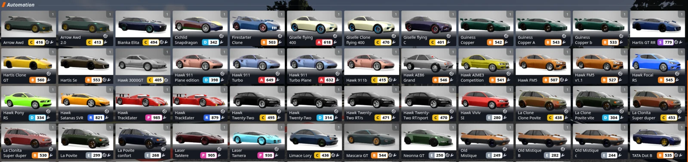

Every car gets a **class letter** (E, D, C, B, A, S, R, P, X) and a **PI number** (100–999), just
like Forza. PI stands for Performance Index: the higher the number, the faster the car. Races can
be limited to one class, so you race cars of a similar speed.

- You see the class and PI in the car list, on the grid, on the race HUD and in the results.
- PI comes from how the car actually accelerates, brakes and corners, checked against real laps
  in the game.
- **Parts change PI, tuning doesn't** (the Forza rule). Adjusting your setup never moves you into
  another class.

### Upgrade your car
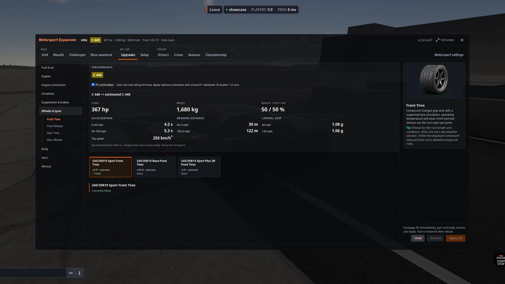
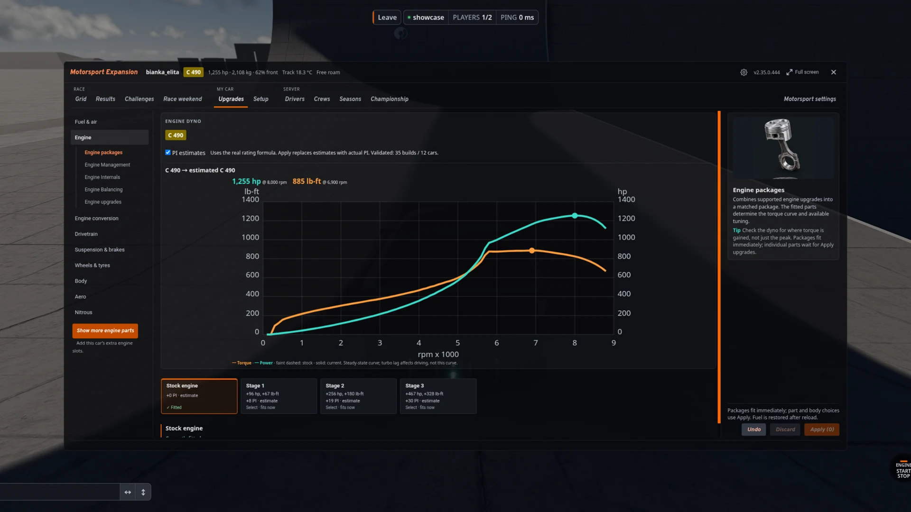

**Automation cars** get a full upgrade shop: tyres (road to race slicks, wider tyres), aero, weight
reduction, brakes, and the engine: intake, exhaust, ECU, camshaft, forged internals, bigger
displacement, turbos, superchargers, twin-charging and sequential twin turbos, coolers and
radiators. A live **dyno** shows what each part does before you buy it. You can also swap in a
different engine or change the drive (front, rear or all-wheel drive).

**Every engine has a limit,** based on its layout and size. A small engine has lots of room to
grow; an engine that's already making huge power only gets a small tune-up. Fitting a turbo or a
bigger displacement raises that limit. Want to go much faster? Swap the engine.

**BeamNG's own cars** can fit their own factory parts, plus BJR:ME's weight-reduction stages and
Sport and Race brakes on many models, and race tyres on a few.

Each part and each setup section has a short guide with a picture, explaining what it does.

### Set up your car
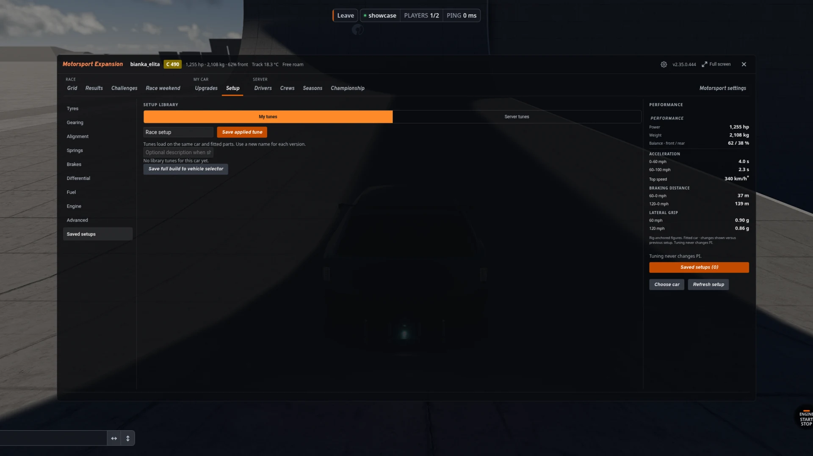

Suspension, aero, brakes, differential, fuel and gearing, with a gearing graph next to the
sliders. Race parts unlock more sliders. Save your setups and load them later.

### Start a race in two clicks
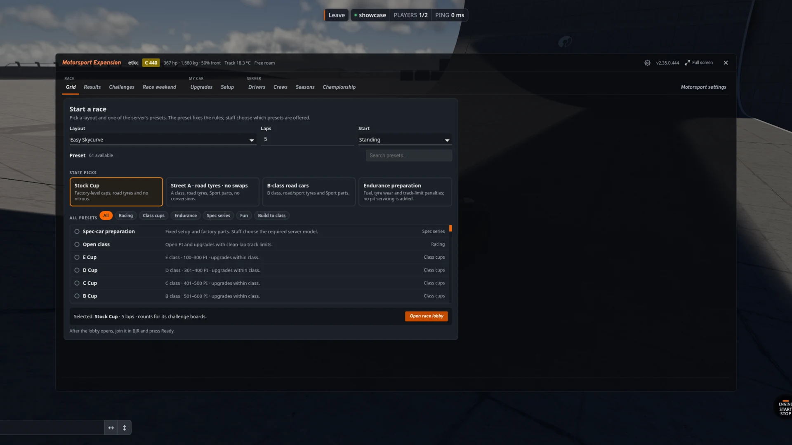

Pick a track layout and one of the server's **presets** (for example "Stock Cup" or "B-class road
cars"). The preset sets the rules, and the race lobby opens. Join it in BeamJoy-Revived, press
Ready, and go.

### Race weekends
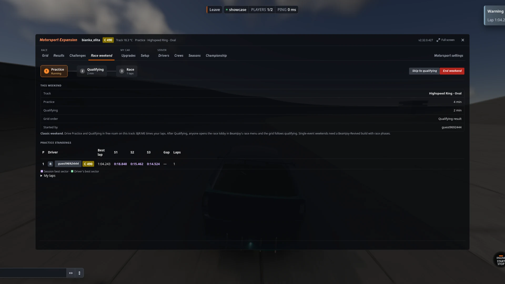

Practice, then qualifying, then the race. Qualifying sets the starting grid. Any driver with
permission can start a weekend.

### Challenges and Rivals
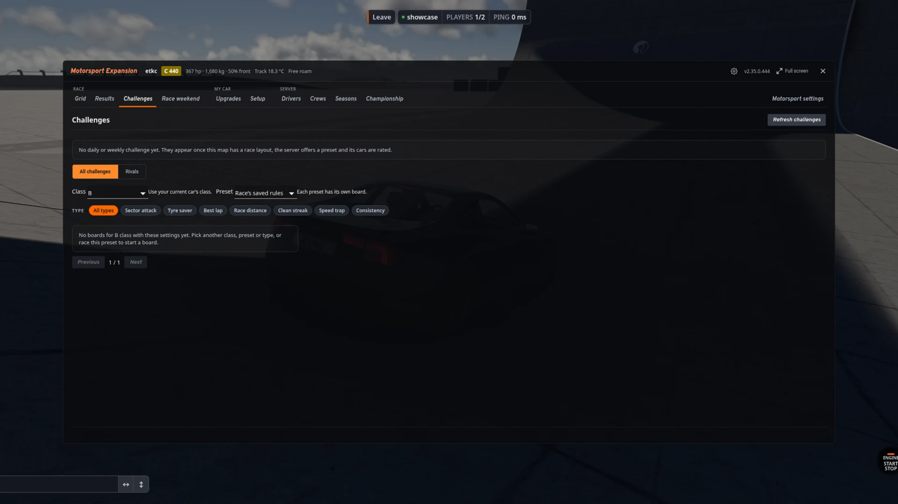

Daily and weekly challenges, plus leaderboards for every track and class: best lap, sector
attack, speed trap, tyre saver, race distance, clean streak and consistency. Chase another
driver's lap against their **ghost car**. The server checks every lap, so the boards stay honest.
You get a notice when someone beats your time.

### Licences, levels and crews
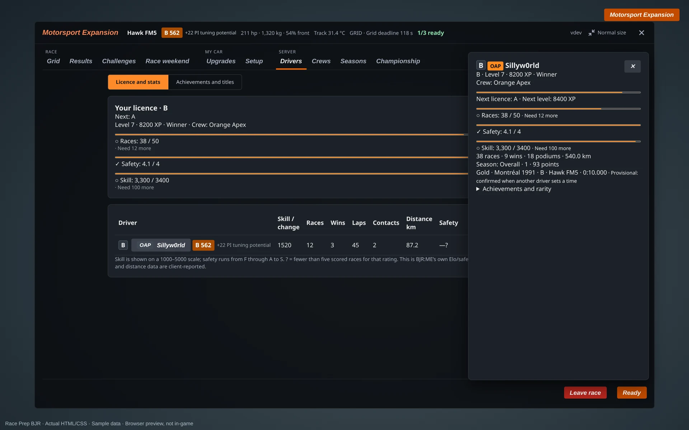
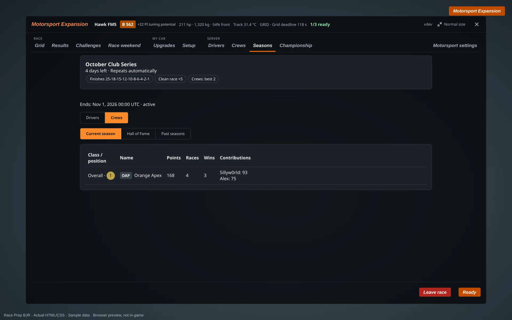

Earn XP, levels, medals, achievements and **licences** by racing. Click any driver's name to see
their card. Start a **crew** with your friends and race for the monthly season table, for drivers
and for crews.

### A living track
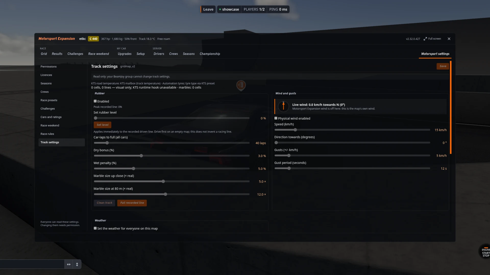

- A **rubbered racing line** builds up lap by lap and gives more grip, with **marbles** (rubber
  bits) off the line that cost grip if you drive through them.
- **Track temperature** follows the sun, clouds and rain.
- **Weather and wind** are shared with BeamJoy-Revived's weather panel.

### Race HUD
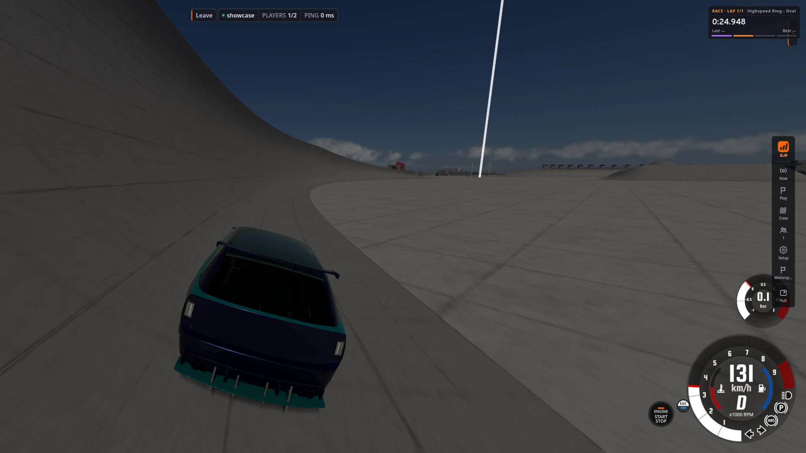

Position, gaps, sectors, penalties and the session clock while you race, plus a timing tower and an
optional proximity radar. Switch each one on or off with the **gear icon** at the top of the window.

## Hosting a server

### What you need
- **BeamNG.drive 0.40** and a **BeamMP server** (version 3.9.4 or newer for the checked
  Challenges laps).
- **BeamJoy-Revived 2.0.1 or newer**, installed first.
- Windows or Linux (64-bit). You don't need to install Python or anything else.

With the normal BeamJoy-Revived release, race weekends run in **classic mode**: practice and
qualifying are timed by BJR:ME, and the race is a normal BeamJoy race with the qualifying grid. If
you run a BeamJoy-Revived version with race phases, full weekends switch on by themselves. The
server console tells you which mode you're in when it starts. BeamJoy-Revived's upcoming pit system
isn't part of BJR:ME yet.

### Optional mods
These work with BJR:ME when they're on your server. They aren't included. Download them from their
pages, or type `bjrme get kts` (or `fluidspill`, `ddp`) in the server console and they install on
the next start.
- [Kagoni's Tyre Simulation](https://www.beamng.com/resources/kagoni%E2%80%99s-tyre-simulation.39079/)
  by Kagoni: tyre heat and wear. BJR:ME's tyre compounds and track grip work through it.
- [Fluid Spill Mod](https://www.beamng.com/resources/fluid-spill-mod.38681/) by Dirt 2: oil, coolant
  and fuel spills (it has its own server plugin).
- [Dynamic Damage Particles](https://www.beamng.com/resources/dynamic-damage-particles.38670/) by
  samllea1: debris from crashes.
- Automation car mods: the cars BJR:ME builds upgrades for.

### Which download?
There are two editions. They're the same, except for the cars used for engine swaps:
- **Play** (`bjrme-play-windows-x64.zip` or `bjrme-play-linux-x64.zip`): **pick this one if you're
  not sure.** It includes my 18 swap engines and the front, rear and all-wheel-drive conversions, so
  everything works straight away.
- **Custom** (`bjrme-custom-…zip`): no swap engines included. For servers that want to add their
  own Automation engines in `BJRME-donors/custom/`.

### Install in three steps
1. Install BeamJoy-Revived on your BeamMP server.
2. Unzip the BJR:ME download into your **BeamMP server folder**. It doesn't touch any
   BeamJoy-Revived file.
3. Start the server with `start-bjrme-server.cmd` (Windows) or `./start-bjrme-server.sh ./BeamMP-Server`
   (Linux). The first start builds the upgrade parts for your cars, which takes a few minutes; later
   starts only build parts for new cars. If your host starts BeamMP for you, start it as usual:
   BJR:ME builds the parts in the background and tells you when to type `reloadmods`.

Everything else (who can change rules, race presets, seasons, engine limits) is set in the window
under **Motorsport settings**, or explained in the guides below.

**Guides:** [installation](docs/distribution/INSTALLATION.md) ·
[everyday use and console commands](docs/distribution/USAGE.md) ·
[adding your own swap engines](docs/distribution/CUSTOM-DONORS.md) · [all documentation](docs/README.md)
· [current status](docs/STATUS.md)

For the curious, how it was built and tested: [PI and classes](docs/methodology/PI-AND-CLASSES.md),
[upgrades and conversions](docs/methodology/CONVERSIONS.md), [testing](docs/methodology/TESTING.md) and
[how it came together](docs/AUTHORSHIP.md).

## Contributing
Found a bug or have a question? Report it on the [Discord](https://discord.gg/m6urHk6EAK). Contributions are welcome: please
read [CONTRIBUTING.md](CONTRIBUTING.md) and [GOVERNANCE.md](GOVERNANCE.md) first. Performance and
rating changes need reproducible evidence.

## Credits
| Project / people | Contribution |
| --- | --- |
| [BeamJoy-Revived — Captain Nugget / foodcache3 and contributors](https://github.com/foodcache3/BeamJoy-Revived) | Multiplayer framework this expansion runs on. BJR:ME works through BJR's plugin API and adds nothing to BJR's own folders. |
| [BeamJoy — my-name-is-samael and contributors](https://github.com/my-name-is-samael/BeamJoy), including [BeamJoy-sandbox](https://github.com/my-name-is-samael/BeamJoy-sandbox) | Original project and upstream lineage continued by BeamJoy-Revived. |
| [Kagoni Tyre Simulation — Kagoni](https://www.beamng.com/resources/kagoni%E2%80%99s-tyre-simulation.39079/) | Optional tyre simulation; integrated unmodified through its public interfaces. Installed separately. |
| [Fluid Spill Mod — Dirt 2](https://www.beamng.com/resources/fluid-spill-mod.38681/) | Optional oil, coolant and fuel spills, with its own BeamMP server plugin. Installed separately; BJR:ME contains none of its code. |
| [Dynamic Damage Particles — samllea1](https://www.beamng.com/resources/dynamic-damage-particles.38670/) | Optional crash debris. Its debris technique inspired BJR:ME's tyre debris; no code is shared. Installed separately. |
| [BeamMP team and contributors](https://beammp.com/) | Multiplayer platform and server/client transport. Installed separately. |
| [BeamNG GmbH and the BeamNG.drive team](https://www.beamng.com/) | Game, vehicle physics, native vehicles/parts and modding interfaces. Installed separately. |
| [Camshaft Software / Automation team](https://automationgame.com/) | Vehicle/engine design and BeamNG export tools used to create the Automation cars and donor exports. |
| Vehicle and mod authors | The installed cars from which compatible upgrades are generated. Their models, sounds and source assets remain their work. |

Design inspiration, development tools and more: [CREDITS.md](CREDITS.md). Legal notices: [NOTICE](NOTICE).
